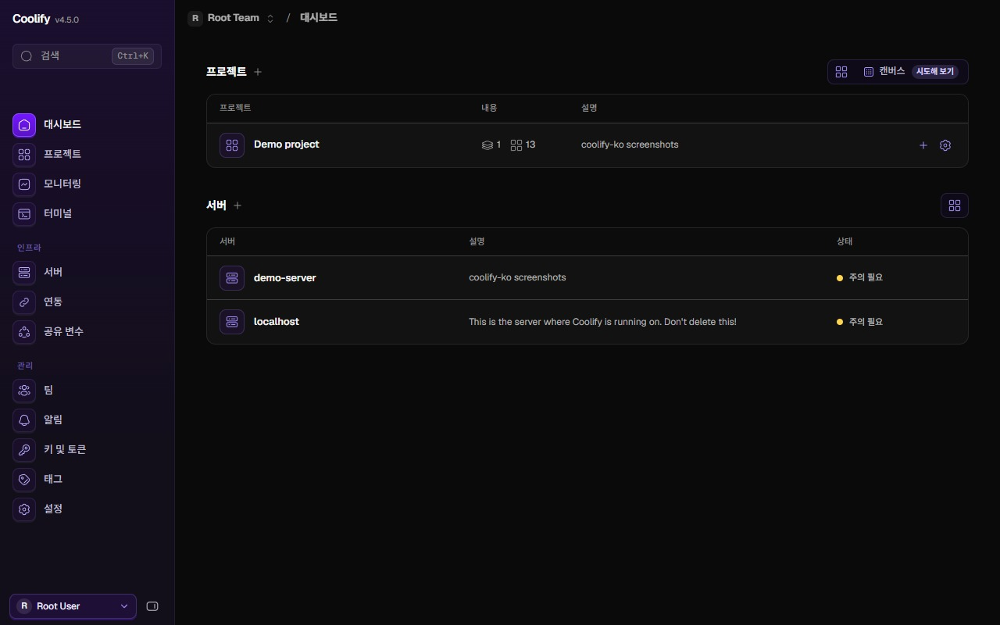

<div align="center">


# coolify-ko

**자체 호스팅 Coolify를 한국어로.**<br>
공식 이미지 위에 번역만 더한 비공식 한국어 지원 프로젝트입니다.

[](https://github.com/coollabsio/coolify/releases)
[](https://chromewebstore.google.com/detail/coolify-%ED%95%9C%EA%B5%AD%EC%96%B4-%EB%B9%84%EA%B3%B5%EC%8B%9D/hjfmiecbkiimkbnhoedjicaccmdaihni)
[](https://coolify-ko.geonwoo.dev)
[](https://coolify-ko.geonwoo.dev)
[](LICENSE)

[설치](#현재-서버에-적용추천) · [새로 설치](#번역된-이미지로-새로-설치) · [브라우저 확장](#브라우저-확장) · [로드맵](#로드맵) · [문서](#문서) · [English](#english)



</div>

> [!NOTE]
> 본 프로젝트는 Coolify 개발사인 coolLabs와 무관한 비공식 프로젝트입니다. Coolify는 coolLabs의 Apache-2.0 라이선스 오픈소스 프로젝트입니다.

## 특징

- **번역만 적용합니다.** 공식 이미지 위에 번역 파일만 덮어씌우며, 업데이트는 공식 `upgrade.sh`를 그대로 사용합니다.
- **한 줄 명령어로 원상 복구:** 공식 훅(Hook) 두 곳(`docker-compose.custom.yml`의 이미지 설정, `.env`의 `VERSIONS_URL`)만 변경하므로 언제든 깔끔하게 되돌릴 수 있습니다.
- **서명된 안전한 이미지:** amd64 및 arm64 이미지를 cosign으로 서명하여 신뢰할 수 있는 빌드를 배포합니다.
- **서버 수정 없이 사용 가능:** 서버 설정을 직접 변경하기 어려운 환경이라면, 브라우저 확장 프로그램을 통해 내 브라우저 화면에만 한국어를 적용할 수 있습니다.

## 로드맵

- [x] Coolify 최신 버전 자동 번역 및 배포
- [x] AI 번역 및 번역 검수 파이프라인 구축
- [ ] Safari 확장 프로그램 출시
- [ ] 번역 검수 파이프라인 커뮤니티 개방
- [ ] coolify-korean 프로젝트를 자체 호스팅에서 무료 호스팅으로 전환

## 현재 서버에 적용(추천)

이미 Coolify를 사용하고 계신 서버라면 이 방법을 권장합니다. 해당 서버에 접속하는 모든 사용자가 한국어 화면을 이용할 수 있습니다.

```bash
# 1. 스크립트를 다운로드하고 해시를 검증합니다 (결과: coolify-ko.sh: OK)
curl -fsSLo coolify-ko.sh https://coolify-ko.geonwoo.dev/coolify-ko.sh
curl -fsSL https://raw.githubusercontent.com/Kim-Geonwoo/coolify-korean/main/scripts/coolify-ko.sh.sha256 | sha256sum -c -

# 2. 한국어 패치를 설치합니다
sudo bash coolify-ko.sh install
```

원래대로 되돌릴 때도 명령어 한 줄이면 충분합니다.

```bash
sudo bash /data/coolify/source/coolify-ko.sh uninstall
```

`docker-compose.custom.yml`에 이미 `coolify` 서비스 설정을 추가해 둔 서버는 [설치 상세](docs/install.md#방법-a-지금-서버에-얹기)를 참고하세요.

## 번역된 이미지로 새로 설치

새 서버를 구축하는 중이라면 공식 설치를 진행하기 전에 미리 준비해 둘 수 있습니다. 첫 부팅 시점부터 한국어로 시작됩니다. 위 안내대로 스크립트를 다운로드하고 검증한 뒤 실행합니다.

```bash
sudo bash coolify-ko.sh preinstall
```

`preinstall` 명령을 실행하면 공식 설치 명령이 출력됩니다. 출력된 명령을 그대로 실행하시면 됩니다. 구체적인 순서와 주의사항은 [새로 설치 상세](docs/install.md#방법-b-새로-설치)에서 확인하실 수 있습니다.

## 브라우저 확장

서버 설정은 전혀 건드리지 않고, 내 웹 브라우저에서만 Coolify 화면을 한국어로 표시합니다.

| 브라우저 | 설치 |
|---|---|
| Chrome | [Chrome 웹 스토어](https://chromewebstore.google.com/detail/coolify-%ED%95%9C%EA%B5%AD%EC%96%B4-%EB%B9%84%EA%B3%B5%EC%8B%9D/hjfmiecbkiimkbnhoedjicaccmdaihni) |
| Firefox | [coolify-ko.geonwoo.dev](https://coolify-ko.geonwoo.dev)에서 서명된 `.xpi` 파일을 내려받습니다 (버전 및 SHA-256 해시 제공, 새 버전 자동 업데이트 지원) |

확장 프로그램은 사용자가 지정한 Coolify 주소에서만 동작하며, 화면의 텍스트나 데이터를 외부로 전송하지 않습니다. 자세한 내용은 [확장 상세](docs/install.md#방법-c-브라우저-확장)와 [개인정보 처리방침](https://coolify-ko.geonwoo.dev/privacy)을 참고하세요.

## 문서

| 문서 | 내용 |
|---|---|
| [설치와 되돌리기](docs/install.md) | 설치 방법별 상세 안내, 공식 버전 복구, 이미지 서명 확인(cosign) |
| [동작 원리와 보안](docs/how-it-works.md) | 공식 훅 활용 방식, 보안 모델, 제약 사항, 프로젝트 종료 정책 |
| [개발](docs/development.md) | 빌드 및 변환 파이프라인, 개발 환경, 검증 절차, 로컬 테스트 인스턴스 |
| [번역 범위](reports/coverage.md) | 지금 판의 변환 및 번역 현황 |

공식 웹사이트: https://coolify-ko.geonwoo.dev · 컨테이너 이미지: `ghcr.io/kim-geonwoo/coolify-ko`

## 라이선스와 상표

- 본 저장소는 Coolify와 동일하게 [Apache License 2.0](LICENSE)을 따릅니다.
- 오버레이 이미지 속 수정된 파일과 `i18n/`의 영어 원문은 Coolify 프로젝트의 소스코드에서 유래했습니다. 상세 출처와 저작권 정보는 [NOTICE](NOTICE)에 명시되어 있으며, 수정한 파일마다 상단에 라이선스 및 변경 고지가 포함되어 있습니다.
- "Coolify" 명칭과 로고는 coolLabs Solutions Kft.의 등록 상표입니다. 본 프로젝트는 비공식 프로젝트이며 coolLabs와 어떠한 제휴나 공식적인 보증 관계도 없습니다. Coolify 공식 로고를 본 프로젝트의 대표 이미지로 사용하지 않습니다.

## 문의

개발자 문의: kgw@geonwoo.dev

번역이 어색한 곳은 [번역 제보](https://github.com/Kim-Geonwoo/coolify-korean/issues/new?template=translation.yml)로, 보안 문제는 공개 이슈 대신 [보안 정책](SECURITY.md)대로 알려 주세요.

Developer contact: kgw@geonwoo.dev

## English

An unofficial Korean build of the Coolify dashboard, not affiliated with coolLabs. Self-hosters can apply it in three ways. Method A switches an existing instance. Method B prepares a new server before running the official installer. Method C is a browser extension that changes nothing on the server. Methods A and B change only two official hooks: the `coolify` image in `docker-compose.custom.yml` and `VERSIONS_URL` in `.env`. Updates still run through the official `upgrade.sh`. To revert, run `sudo bash /data/coolify/source/coolify-ko.sh uninstall`, or delete the marked blocks by hand. Images are built for amd64 and arm64.
